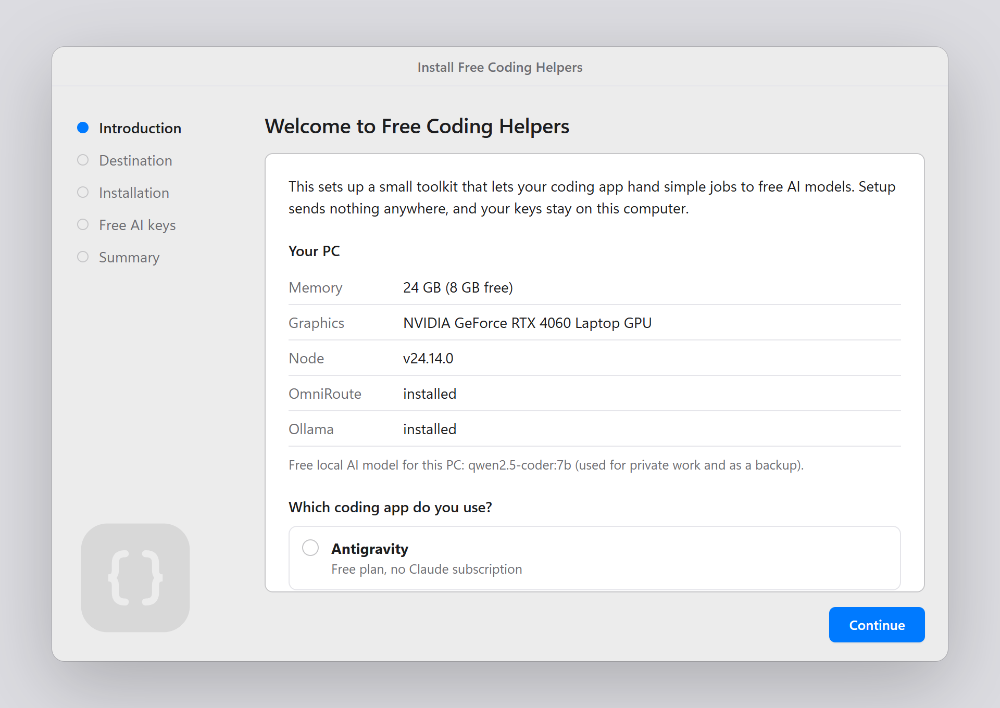

# free-coding-helpers

The `fcode` command hands small, checkable coding jobs from Claude Code (or another coding agent) to free AI models, so the paid model is kept for design and thinking.

<picture><source media="(prefers-color-scheme: dark)" srcset="docs/setup-dark.png"></picture>

## Why this exists

I kept running out of my Claude usage limit while coding. Most of what I was spending it on was small, boring work: a one-file bug fix, a test, a rename. So I started handing those jobs to free AI models and keeping the paid model for design and thinking. It worked well enough that I wrapped it into this tool, measured which free models actually hold up, and made an installer so friends could use it too.

**Built on OmniRoute.** The hard part of talking to many free providers (storing keys, one endpoint for all of them) is done by [OmniRoute](https://www.npmjs.com/package/omniroute), a separate open-source gateway that this project installs and uses. This project is the layer on top: the job runner with its pass-your-check gate, pacing under each provider's free limits, the provider catalog, the benchmark, and the setup app.

## What it does
```sh
node toolkit/fcode.js <edit|bugfix|tests|refactor|feature|explain|review> "<task>" --root . --files a.js,b.js --check "<cmd>"
```
It edits a scratch copy of only those files, runs your check command, and writes the change back only if the check passes. It never commits or pushes. A failed run leaves your files untouched (exit 1).

Good fits are jobs scoped to 1-3 named files that have a check command which fails before and passes after (a failing test, a lint, a script). Not for design, cross-file debugging, or money/auth/security/migration code.

## Quick start
You need Node 20 or newer.

- **Windows:** download `free-coding-helpers.zip` from the Releases page, unzip it, double-click `setup.bat`.
- **macOS / Linux:** unzip it, then run `sh install.sh`.

The setup app finds Node, OmniRoute, Ollama and your graphics card, installs only what is missing (Linux sudo steps are printed for you, never run), then walks you through free provider keys. Groq and Google Gemini are marked "start here". Each key is tested with a free call (no tokens) and saved only inside OmniRoute, never in a file, a log or on a command line. Full plain-words guide: toolkit/README.md.

## How it works
The router (toolkit/router.js) tries models in order per job type; paces each model under 80% of its published per-minute, per-hour and per-day limits using a small per-model usage diary of the last 24 hours; reads cooldowns from 429 replies ("reset after 3s", retry-after); skips a request that is too big for a model's per-minute token cap instead of retrying it; moves to the next model when one is cooling down; treats "payment required" as fatal for that model.

OmniRoute (a separate open-source gateway, installed from npm as `omniroute`) holds your provider keys encrypted and gives one local endpoint. Ollama runs local models for private jobs: `--local-only` never sends code to the cloud.

Providers catalog (toolkit/providers.json): 11 free-tier providers with sign-up page, key page, key format, free limits, the source of each number and how sure we are. Free tiers change often; the file says where each number came from.

Things we measured that the docs do not say: Groq rejects a single request whose prompt plus requested reply is over 8,000 tokens per minute; Codestral blocked after 3-4 calls in a minute ("reset after 3s"); OmniRoute hides the providers' rate-limit headers, so the router counts its own calls (calls made by other tools with the same keys are not counted).

## Benchmark results
57 tasks on a small "ledger" project: 16 edits, 13 bug fixes, 7 tests, 8 refactors, 7 features, 5 explains, 1 review; every task has a check that fails before and passes after; each model ran alone, November 2026.

| Model | Score |
|-------|-------|
| Groq gpt-oss-120b | 54/57 |
| NVIDIA nemotron-3-ultra | 53/57 |
| Google gemini flash-lite | 49/57 |
| Groq qwen3.8-27b | 40/57 |
| Groq gpt-oss-20b | 15/57 |

Groq gpt-oss-120b is fastest at about 2 s per call. NVIDIA nemotron-3-ultra is about 14 s per call. Groq gpt-oss-20b hit its daily cap mid-run, so this is not a quality score. Mistral Codestral started returning "payment required" half way, so it is no longer free.

Re-run it yourself (tasks in `jobs.json`, project in `sandbox/`):
```sh
node toolkit/fcode.js bench --name mine
node toolkit/fcode.js report mine
node toolkit/rules.js mine --write   # reorder the model chains from your results
node toolkit/savings.js              # page of tokens and dollars saved
```

## Honest limits

- Free tiers change without warning. Mistral Codestral went from free to "payment required" in the middle of our benchmark run.
- The benchmark is 57 small tasks on one small practice project, not real-world code. Treat the scores as a rough guide.
- Free models are good at small, well-checked jobs. For design or bugs spread across many files, use a stronger model.
- OmniRoute hides each provider's "how much is left" information, so the pacing counts its own calls only. Other tools using the same keys are not counted.
- The guide for running Claude Code itself on free models (`toolkit/claude-code-mode.md`) has not been tested end to end.

## Safety
Never send real user data, logs, secrets or keys to cloud models; use --local-only for sensitive jobs; list protected files in a `.fcode-deny` file; helper output is a draft, so read `git diff` and run your tests before trusting it.

## Contributing
Issues and pull requests welcome. Run the tests with `cd toolkit && node --test "test/*.test.js"` (no keys needed). The setup app is modelled on the macOS Installer; its design notes are in `toolkit/DESIGN.md`. New provider entries need a source for every number. New benchmark tasks need a check that fails before and passes after a known-good fix.

## License
MIT (see LICENSE).
